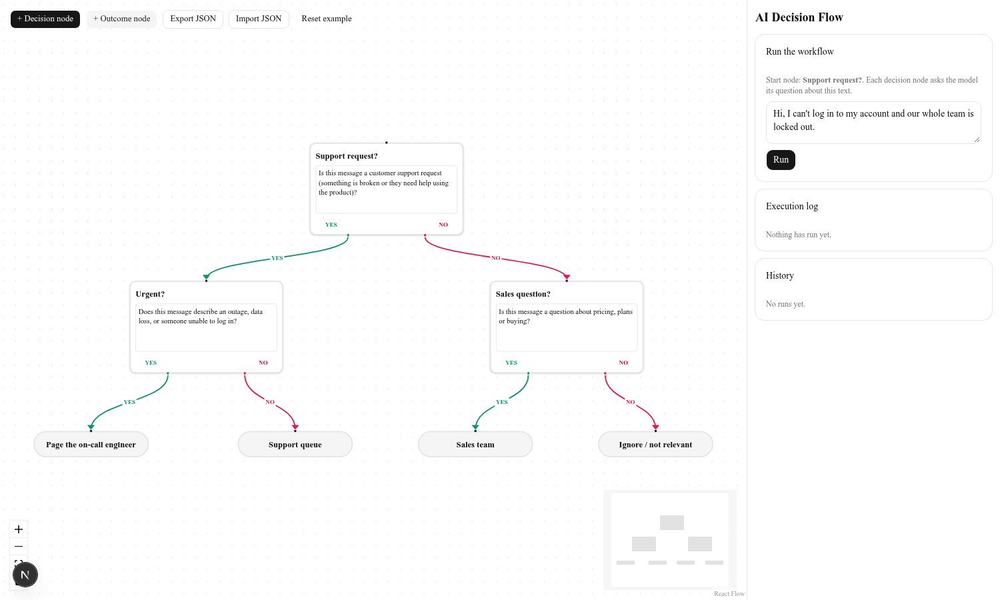
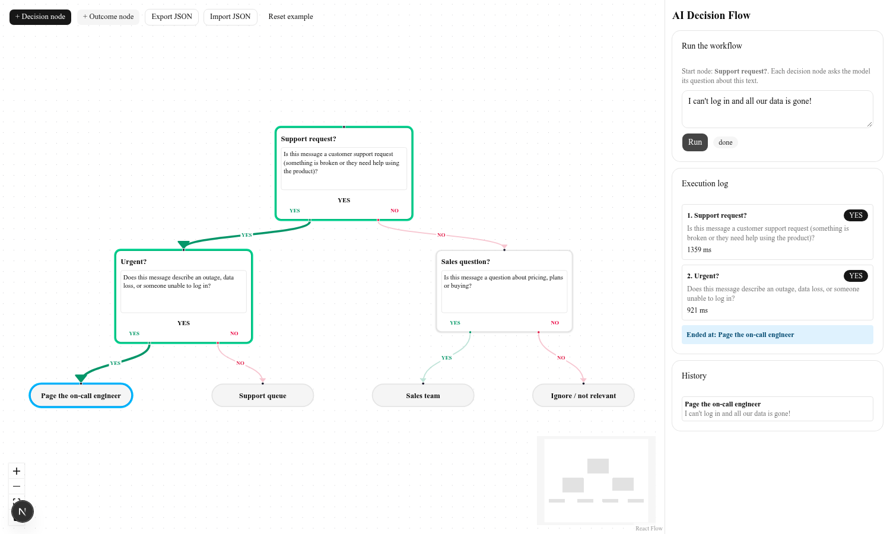
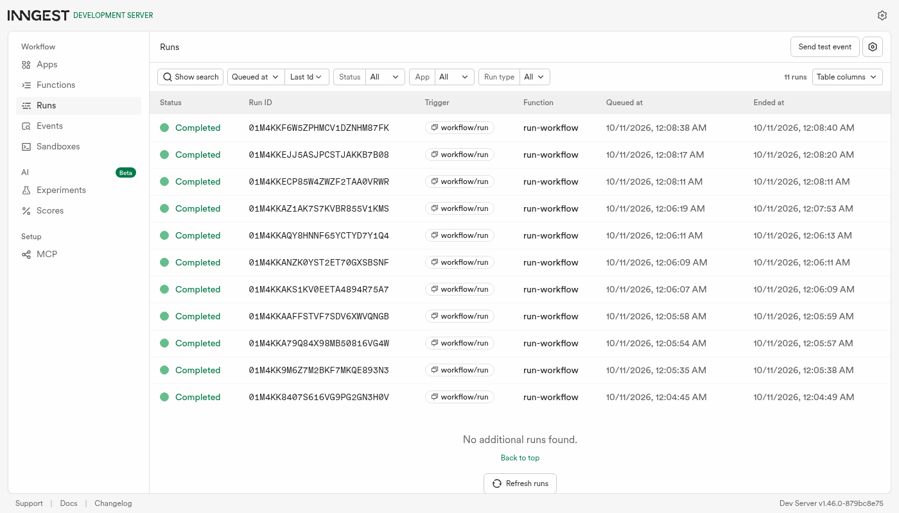

# AI Decision Flow

A visual workflow builder where every node is a YES/NO question answered by an AI model. You draw the graph in the browser, type a message, and the workflow walks the graph: each decision node asks the model its question about the message, and the answer picks the next edge, until it reaches an outcome node. The walk runs on [Inngest](https://www.inngest.com), one durable step per node.

Example (included, loaded by default): *"Is this a support request?"* YES goes to *"Urgent?"*, NO goes to *"Sales question?"*, and those lead to four outcomes (on-call engineer, support queue, sales team, ignore).





## Stack

Next.js 16 (App Router, TypeScript, Tailwind), `@xyflow/react` (React Flow 12), Inngest SDK v4 + the Inngest dev server, the `openai` SDK pointed at OpenRouter (any OpenAI-compatible endpoint works), shadcn/ui.

## Run it

Needs Node 20+. Two terminals:

```bash
npm install
cp .env.example .env.local      # then fill in LLM_API_KEY
npm run dev                     # app on http://localhost:3000
npm run inngest                 # Inngest dev server on http://localhost:8288
```

`npm run inngest` runs the CLI from `inngest-cli` (a dev dependency). npm 12 blocks install scripts, so if `node_modules/inngest-cli/bin/inngest` is missing run `node node_modules/inngest-cli/postinstall.js` once to download it. Alternative: `npx inngest-cli@latest dev -u http://localhost:3000/api/inngest`.

Checks: `npm run typecheck` (runs `next typegen` first; Next 16 generates the `LayoutProps` types) and `npm run lint`.

Open http://localhost:3000, press **Run**, and watch the nodes light up. The Inngest dashboard at http://localhost:8288 shows each run and its steps.

### Environment variables

| Variable | Meaning |
| --- | --- |
| `LLM_BASE_URL` | OpenAI-compatible base URL (default in `.env.example`: OpenRouter) |
| `LLM_API_KEY` | API key for that endpoint. Never commit it: `.env*` is git-ignored except `.env.example` |
| `LLM_MODEL` | Model id. Tested with the free `nvidia/nemotron-3-super-120b-a12b:free` |
| `INNGEST_DEV` | `1` makes the SDK talk to the local dev server (no event/signing keys needed) |
| `LLM_STUB` | `1` skips the model and answers from a keyword check, for offline tests |

Try a run from the terminal without the UI (app and Inngest must be running):

```bash
node scripts/run-example.mjs "I can't log in and all our data is gone!"
# 1. Support request? -> YES   2. Urgent? -> YES   ended at: n4 (Page the on-call engineer)
```

## How it works

- **Canvas** (`src/components/FlowEditor.tsx`): decision nodes have an editable title and prompt and two source handles, YES and NO. Outcome nodes are endpoints. Add and delete nodes, drag to connect; a handle holds one edge, so reconnecting replaces it. The graph autosaves to `localStorage`.
- **Run** (`POST /api/run`): validates the graph (1-50 nodes, no empty prompts, a start node exists; a decision node with no edge for its answer just ends the run there), stores a run record, and sends the event `workflow/run` to Inngest. It returns `202 {runId}` immediately.
- **Execution** (`src/inngest/functions.ts`): the function `run-workflow` starts at the node with no incoming edge. Each decision node is `step.run("decide-<node>-<n>")`, which calls the model and returns `"YES"` or `"NO"`; the matching edge is followed. Execution order, answer and latency per node are written to the run record. A cap of 20 steps stops cycles.
- **Model contract** (`src/lib/llm.ts`): the system prompt demands one word, YES or NO. Temperature 0. The question and the user text are sent JSON-encoded as `{QUESTION, INPUT}` so the text being classified can't pose as instructions. The reply is parsed strictly: it must start with YES or NO (leading punctuation is ignored), anything else is an error rather than a guess. `max_tokens` is 400 because some free models emit reasoning first.
- **Run state** (`src/lib/runstore.ts`): the UI polls `GET /api/runs/<id>` every 600 ms. Records are JSON files in `.runs/` (git-ignored), which is enough for a single-machine demo.

## Phase 4 options implemented (needed 3)

- Visual execution state: nodes get a ring while running/answered, the end node is highlighted, the model's answer shows on the node.
- Animated active edges: the taken edge is bold and animated; edges not taken fade.
- Execution logs panel: per-node prompt, answer, time in ms, and the end node.
- Execution history: the last 10 runs (kept in `localStorage`); click one to load its run onto the canvas.
- Save/load (autosave to `localStorage`) and JSON export/import of the graph.
- Error handling: bad key, model errors, or an unparseable answer end the run with a visible error and the failing node marked. Auth and not-found errors (401/403/404) are non-retriable; other failures use Inngest's retries (`retries: 2`).
- Retry: a **Retry run** button appears after a failed run.

## Honest limits

- **Retry re-runs the whole workflow**, not only the failed node. Inngest retries the failing step on its own (2 retries) before the run is marked failed.
- Inngest runs in dev mode here. Deploying means setting `INNGEST_EVENT_KEY` / `INNGEST_SIGNING_KEY` and syncing the app; I did not test that.
- Run records live on local disk, so this won't survive serverless hosting as is. A database table would replace `runstore.ts`.
- No auth on the API routes; anyone who can reach the app can spend your model quota. Input is capped at 2000 characters.
- The model is a free one: answers on the example were right on the handful of messages I tried (login outage, feature bug, pricing, birthday greeting), but a YES/NO from an LLM is a judgment call and can be wrong on ambiguous text. Write prompts as sharp questions.
